 

&nbsp;&nbsp;&nbsp;&nbsp;

  

<picture>
  <source media="(prefers-color-scheme: dark)" srcset="assets/zoom-dark.svg" />
  
</picture>

## Research

- **[VERITAS-NLI](https://github.com/Hetens/VERITAS-NLI)**: fact-checks headlines against live web evidence with NLI models. Published in *Engineering Applications of AI*.
- **[Phase Without Position](https://github.com/Hetens/ComplexWeightTransformer)**: can complex-valued weights learn RoPE on their own? No, across 270 runs at three scales.

## Tools

- **[qwatch](https://github.com/Hetens/qwatch)**: a terminal dashboard for your HPC cluster jobs, over the SSH config you already have.

## By the numbers

<picture>
  <source media="(prefers-color-scheme: dark)" srcset="assets/stats-dark.svg" />
  
</picture>

## Toolbox

 

 

<picture>
  <source media="(prefers-color-scheme: dark)" srcset="assets/snake-dark.svg" />
  
</picture>

## Say hi

Happy to chat about interpretability, world models, or why your probe is lying to you.
 Find me on LinkedIn, by email, or on Discord at **`bubbles7545`**.

Stats and snake regenerate every 12h via <a href=".github/workflows/profile.yml">GitHub Actions</a>.

